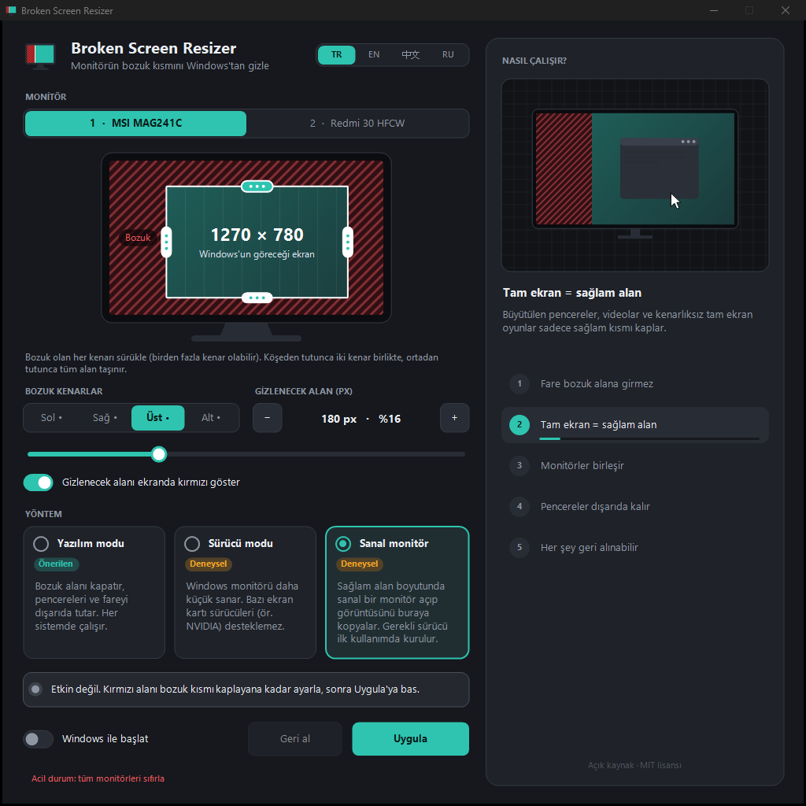

# Broken Screen Resizer

**Kırık veya ölü pikselli monitörünü çöpe atma.** Broken Screen Resizer, monitörünün bozuk kısımlarını Windows'tan gizler; Windows monitörü sanki sadece sağlam kısımdan ibaretmiş gibi kullanır.



*English below · 中文 · Русский arayüz dilleri de mevcut.*

> Önceki adı **Ekran Kurtar**'dı. v1.5 ile adı Broken Screen Resizer oldu; eski ayarlar ve "Windows ile başlat" kaydı kendiliğinden taşınır.

---

## Ne yapar?

Monitörünün bozuk kenarlarını seçersin: sol, sağ, üst, alt ya da **birkaçı birden**. Kalan sağlam dikdörtgen, ekranın herhangi bir yerinde olabilir. Broken Screen Resizer bozuk şeritleri Windows'tan saklar:

- **Birden fazla bozuk kenar.** Ör. hem sol hem alt kenar bozuksa ikisini de kesersin; Windows sadece ortada kalan sağlam dikdörtgeni görür.
- **Tam ekran = sağlam alan.** Oyunlar, videolar ve büyütülen pencereler sadece sağlam kısmı kullanır.
- **Fare bozuk alana giremez.** Windows için o alan yoktur.
- **Ölü alan yok.** Birden fazla monitörde, bir monitörün bittiği yerden diğerine doğrudan geçersin.
- **Her şey geri alınabilir.** Her değişiklik 15 saniyelik onay ister; onaylamazsan kendiliğinden geri döner. Tek tuşla eski haline dönebilirsin.
- **Görsel ayar.** Monitör çiziminde sağlam alanın dört kenarını ayrı ayrı sürüklersin; köşeden tutunca iki kenar birlikte, ortadan tutunca tüm alan taşınır. İstersen kenarı seçip kaydırıcı ya da −/+ ile piksel piksel ayarlarsın. Ayar yaparken bozuk alan gerçek ekranda kırmızıyla gösterilir.
- **Nasıl çalışır paneli.** Her özelliği küçük animasyonlarla anlatır; bir ayarın üstüne gelince o ayarın ne yaptığını canlandırır.
- **4 dil:** Türkçe, English, 中文, Русский.

## Üç yöntem

| | Yazılım modu (önerilen) | Sürücü modu (deneysel) | Sanal monitör (deneysel) |
|---|---|---|---|
| Nasıl çalışır | Her bozuk kenarı görev çubuğu gibi rezerve edip kapatır; fareyi düşük seviyeli kancayla yönlendirir, taşan pencereleri geri iter | Windows ekran yapılandırmasında masaüstünü sinyalin sağlam dikdörtgenine yerleştirir; NVIDIA'da bu reddedilirse NVIDIA Warp ile dener | Sağlam alan boyutunda sanal bir monitör açar, fiziksel monitörün yerine koyar ve görüntüsünü Windows Büyüteç API'siyle sağlam alana 1:1 kopyalar |
| Uyumluluk | Her sistem | Ekran kartı sürücüsüne bağlı. NVIDIA GeForce'ta Warp yeni sürücülerde genelde kapalı | Windows 10 (1903+) / 11. Programın kendi sanal ekran sürücüsü exe'nin içindedir, ilk kullanımda kurulur |
| Tam ekran oyunlar | Kenarlıksız pencere modunda | ✅ | Kenarlıksız pencere modunda; biraz gecikme ekler |
| Program kapalıyken | Program çalışmalı | Ayar kalır | Program çalışmalı; kapanınca ekran düzeni eski haline döner |

Yazılım modu varsayılandır. Deneysel bir yöntem başarısız olursa program hiçbir şeyi değiştirmeden yazılım moduna geçmeyi önerir.

### Sanal monitör yöntemi

Ayrı bir program indirmene gerek yok; sanal ekran sürücüsü `BrokenScreenResizer.exe`'nin içindedir.

1. **Sanal monitör** yöntemini seç ve **Uygula**'ya bas.
2. Sürücü kurulu değilse program "Kurulsun mu?" diye sorar. **Kur ve devam et** de; Windows bir kez yönetici izni ister.
3. Program sürücüyü kurar, sağlam alan boyutunda sanal monitörü açar, yerine yerleştirir ve aynayı başlatır.

Geri al dediğinde (ya da program kapandığında) ekran düzeni önceki haline döner ve sanal monitör kapatılır. Sürücü kurulu kalır ama monitörsüz durur; hiçbir şey göstermez.

Sürücüyü tamamen kaldırmak için: `BrokenScreenResizer.exe --uninstall-driver`

Eski adlı sürücü ("Ekran Kurtar Virtual Display") kuruluysa, yeni sürücü kurulurken eski aygıt, sürücü paketi ve sertifikası kendiliğinden kaldırılır.

## Kullanım

1. [Releases](../../releases) sayfasından `BrokenScreenResizer.exe` dosyasını indir ve çalıştır (kurulum gerekmez).
2. Bozuk monitörü seç.
3. Monitör çiziminde bozuk olan her kenarı, kırmızı alan bozuk kısmı tam kaplayana kadar sürükle. İnce ayar için **Bozuk kenarlar** bölümünden kenarı seçip kaydırıcıyı ya da −/+ düğmelerini kullan. Kesim olan kenarlar seçicide • ile işaretlenir.
4. **Uygula**'ya bas ve görüntü doğruysa **Böyle kalsın**'ı seç.

İstersen **Windows ile başlat** seçeneğini işaretle; sürücü güncellemesi gibi bir sebeple ayar sıfırlanırsa program açılışta yeniden uygular.

### Acil durum

Bir şeyler ters giderse:

- Uygulamadaki **Acil durum: tüm monitörleri sıfırla** bağlantısına tıkla, ya da
- Komut satırından çalıştır: `BrokenScreenResizer.exe --reset`
- Ya da Windows **Ekran ayarları**'ndan çözünürlüğü "önerilen" değere getir.

## Kaynaktan derleme

Ekstra bir şey kurmaya gerek yok; Windows'ta bulunan .NET Framework 4 derleyicisi kullanılır.

```
build.bat
```

Çıktı: `bin\BrokenScreenResizer.exe`. `driver\package` klasöründeki hazır sürücü paketi exe'nin içine gömülür.

### Sanal ekran sürücüsünü derleme (sadece sürücüyü değiştirdiysen)

Sürücü `driver\` klasöründedir: Microsoft'un IddCx (Indirect Display Driver) altyapısıyla yazılmış, kullanıcı modunda çalışan (UMDF 2) bir sürücü. Uygulama sürücüyle doğrudan konuşur ve sağlam alan boyutunda monitör ekleyip kaldırır.

Gerekenler: Visual Studio 2022 veya 2026, **C++ ile masaüstü geliştirme** bileşeni. WDK kurulu değilse betik Microsoft'un resmi NuGet paketini `driver\.wdk` içine indirir.

```
driver\build_driver.bat
build.bat
```

`build_driver.bat` sürücüyü derler, katalog dosyasını oluşturur ve imzalar. İlk çalıştırmada senin bilgisayarında kendinden imzalı bir sertifika oluşturur ("Broken Screen Resizer Driver Signing", Kullanıcı\Kişisel deposu). Özel anahtar bilgisayarından çıkmaz; pakete sadece açık sertifika (`.cer`) girer. Program sürücüyü kurarken bu sertifikayı Windows'un güvenilen sertifikalarına ekler, kaldırırken siler.

> Not: Kendinden imzalı sürücüler kişisel kullanım ve test için uygundur. Programı geniş çapta dağıtacaksan sürücüyü Microsoft'un imzalama hizmetinden (Partner Center, EV sertifikası gerekir) geçirmen önerilir.

Kurulum günlüğü: `C:\ProgramData\BrokenScreenResizer\driver\install.log`

## Gereksinimler

- Windows 10 veya 11 (sanal monitör yöntemi için Windows 10 1903 veya üstü, 64 bit)
- .NET Framework 4.x (Windows'ta hazır gelir)

## Sürüm geçmişi

- **v1.5:** Yeni ad: **Broken Screen Resizer** (dosya adları İngilizce; eski ayarlar, başlangıç kaydı ve eski adlı sürücü kendiliğinden taşınır). **Birden fazla bozuk kenar:** dört kenar ayrı ayrı kesilebilir, sağlam alan ekranın herhangi bir dikdörtgeni olabilir; üç yöntemin üçü de destekler. Önizlemede kenar, köşe ve tüm alan sürüklenebilir.
- **v1.4:** Sanal monitör modunda takılma ve "pencere görünüyor ama tıklanmıyor" sorunu düzeltildi: ayna ve fare kilidi ayrı iş parçacıklarında çalışıyor, fiziksel monitörün arkasında kalan pencereler otomatik olarak sanal monitöre taşınıyor. Program tekrar açılınca penceresi görünür yere geliyor. `--reset` çalışan programı düzgünce kapatıyor.
- **v1.3:** Programın kendi sanal ekran sürücüsü (IddCx). Virtual Display Driver indirmeye gerek yok; sürücü exe'nin içinde, ilk kullanımda sorup kuruluyor. `--uninstall-driver` ile kaldırılır.
- **v1.2:** Sanal monitör yöntemi (Virtual Display Driver ile) ve NVIDIA Warp destekli sürücü modu. Yazılım modu varsayılan oldu.
- **v1.1:** Yeni arayüz, görsel ayar, "Nasıl çalışır" paneli, 4 dil (Türkçe, English, 中文, Русский).
- **v0.4:** İlk sürüm (adı Ekran Kurtar): sürücü modu ve yazılım modu.

## Lisans

MIT

---

# Broken Screen Resizer (English)

**Don't throw away a monitor with a cracked or dead area.** Broken Screen Resizer hides the broken parts of your monitor from Windows, so Windows treats the monitor as if it only consisted of the working part. (Formerly called *Ekran Kurtar*.)

## Features

- **More than one broken edge.** Cut any combination of the left, right, top and bottom edges; the working area can be any rectangle on the screen.
- **Fullscreen = the working area.** Games, videos and maximized windows only use the working part.
- **The mouse cannot enter the broken area.**
- **No dead zones between monitors.** In multi-monitor setups, the cursor moves directly from one monitor's edge to the next.
- **Fully reversible.** Every change needs confirmation within 15 seconds or it reverts automatically. One click restores everything.
- **Visual setup.** Drag each edge of the working area on the monitor drawing (grab a corner to move two edges, or the middle to move the whole area), or pick an edge and fine-tune it with the slider. The broken area is highlighted in red on the real screen while you adjust.
- **How it works panel** with small animations for every feature.
- **4 languages:** Türkçe, English, 中文, Русский.

## Three methods

- **Software mode (recommended):** reserves and covers each broken edge like a taskbar, redirects the cursor with a low-level mouse hook so it never enters the broken area, and pushes overflowing windows back. Works everywhere; the app must keep running and games need borderless window mode.
- **Driver mode (experimental):** changes the Windows display configuration (`DisplayConfig` desktop image region) so the desktop is placed on the working rectangle of the signal. NVIDIA drivers reject non-centered placement (error 31); in that case the app tries NVIDIA Warp (centered desktop + `NvAPI_GPU_SetScanoutWarping`), which is officially supported on professional GPUs and often disabled on recent GeForce drivers.
- **Virtual monitor (experimental):** creates a virtual monitor the size of the working area using the app's own virtual display driver (built in, installed on first use after asking you), puts it in place of the physical monitor and mirrors it 1:1 onto the working area with the Windows Magnification API. Adds a little latency; the app must keep running, and closing it restores the display layout. Remove the driver with `BrokenScreenResizer.exe --uninstall-driver`. A driver installed by an older *Ekran Kurtar* version is removed automatically when the new one is installed.

If an experimental method fails, nothing is changed and the app offers to switch to software mode.

## Usage

1. Download `BrokenScreenResizer.exe` from [Releases](../../releases) and run it (no installation).
2. Pick the broken monitor.
3. Drag every broken edge until the red area exactly covers the broken part.
4. Press **Apply** and confirm with **Keep changes**.

Emergency reset: use the **Emergency: reset all monitors** link, run `BrokenScreenResizer.exe --reset`, or set the recommended resolution in Windows Display Settings.

## Building

Run `build.bat` on Windows. It uses the .NET Framework 4 compiler included with Windows. Output: `bin\BrokenScreenResizer.exe`, with the driver package from `driver\package` embedded.

The virtual display driver (`driver\`) is an IddCx / UMDF 2 indirect display driver. To rebuild it, install Visual Studio 2022/2026 with the C++ desktop workload and run `driver\build_driver.bat` (it downloads the official WDK NuGet package if the WDK is not installed, then builds, catalogs and signs the driver with a self-signed certificate created on your machine), then run `build.bat`.

## License

MIT
