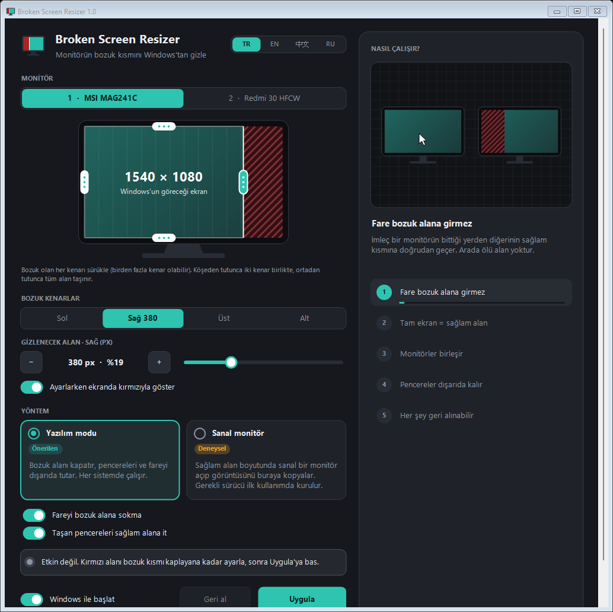

<div align="center">


# Broken Screen Resizer

**Monitörünün bozuk kısmını Windows'tan gizle; geri kalanını tam ekran gibi kullan.**

[](https://github.com/HErkanuzun/BrokenScreenResizer/releases/latest)
[](https://github.com/HErkanuzun/BrokenScreenResizer/releases)
[](https://github.com/HErkanuzun/BrokenScreenResizer/actions/workflows/build.yml)
[](LICENSE)


🇹🇷 **Türkçe** · 🇬🇧 [English](docs/README.en.md) · 🇷🇺 [Русский](docs/README.ru.md) · 🇨🇳 [简体中文](docs/README.zh-CN.md)



</div>

---

## İçindekiler

- [Ne işe yarar?](#ne-işe-yarar)
- [Özellikler](#özellikler)
- [Kurulum](#kurulum)
- [Kullanım](#kullanım)
- [Yöntemler](#yöntemler)
- [Güvenlik ve gizlilik](#güvenlik-ve-gizlilik)
- [Güncelleme ve kaldırma](#güncelleme-ve-kaldırma)
- [Sorun giderme](#sorun-giderme)
- [Komut satırı](#komut-satırı)
- [Kaynaktan derleme](#kaynaktan-derleme)
- [Sürüm geçmişi](#sürüm-geçmişi)
- [Lisans](#lisans)

## Ne işe yarar?

Monitörünün bir kenarında çizgiler, ölü pikseller ya da kırık bir bölge mi var? Broken Screen Resizer o bölgeyi Windows'tan saklar. Windows monitörü sanki sadece **sağlam kısımdan** ibaretmiş gibi kullanır: pencereler, görev çubuğu, tam ekran videolar ve fare bozuk alana girmez.

Monitörü atmak ya da her gün pencereleri elle kaydırmak yerine bir kez ayarlarsın, gerisini program halleder.

## Özellikler

- **Birden fazla bozuk kenar.** Sol, sağ, üst, alt ya da birkaçı birden; sağlam alan ekranın herhangi bir dikdörtgeni olabilir.
- **Görsel ayar.** Monitör çiziminde kenarları sürüklersin; köşeden tutunca iki kenar birlikte, ortadan tutunca tüm alan taşınır. Piksel hassasiyetinde ince ayar için kaydırıcı ve −/+ düğmeleri var.
- **Canlı önizleme.** Ayar yaparken gizlenecek alan gerçek ekranda birkaç saniyeliğine kırmızıyla gösterilir. Program açılışta ekranı asla kendiliğinden boyamaz.
- **Tam ekran = sağlam alan.** Büyütülen pencereler ve videolar sadece sağlam kısmı kullanır.
- **Fare ve pencereler dışarıda.** İmleç bozuk alana giremez; oraya taşan pencereler geri itilir.
- **Her şey geri alınabilir.** Her değişiklik 15 saniyelik onay ister; onaylamazsan kendiliğinden geri döner. Tek tıkla acil sıfırlama da var.
- **Sürüm bilinçli kurulum.** Kurulum paketi program varsa günceller, yoksa kurar; çalışan eski sürüm önce düzgünce kapatılır.
- **Tam kaldırma.** Kaldırınca programın bilgisayarda yaptığı her değişiklik geri alınır, kalıntı bırakmaz.
- **Küçük ekranlara uyumlu.** Pencere boyutlandırılabilir; dar ekranda tek sütuna geçer ve kaydırılır.
- **4 dil:** Türkçe, English, 中文, Русский.

## Kurulum

[**Son sürümü indir →**](https://github.com/HErkanuzun/BrokenScreenResizer/releases/latest)

| Dosya | Ne zaman |
|---|---|
| `BrokenScreenResizer-<sürüm>-Setup.exe` | **Önerilen.** Kurar; zaten kuruluysa günceller. Başlat menüsüne eklenir, Windows "Uygulamalar" listesinde sürümüyle görünür. Yönetici izni istemez. |
| `BrokenScreenResizer-<sürüm>-Portable.zip` | Kurulum istemeyenler için. Çıkart, `BrokenScreenResizer.exe`'yi çalıştır. Kaldırmak için `Uninstall.bat`. |
| `SHA256SUMS.txt` | İndirdiğin dosyanın değişmediğini doğrulamak için özetler. |

> [!NOTE]
> **"Windows kişisel bilgisayarınızı korudu" uyarısı:** Program ücretsiz ve açık kaynaklı olduğu için ücretli bir kod imzalama sertifikası yok. SmartScreen, az indirilmiş her imzasız program gibi uyarı gösterebilir. **Ek bilgi → Yine de çalıştır** ile devam edebilirsin. Dosyanın gerçekten bu depodan çıktığını aşağıdaki gibi doğrulayabilirsin.

### İndirilen dosyayı doğrulama

Sürümdeki her dosya GitHub Actions üzerinde, bu depodaki kaynak koddan derlenir. GitHub da dosyanın hangi koddan ve hangi derlemeden çıktığını imzalı bir kayıtla (*build provenance*) onaylar.

```powershell
# 1) SHA-256 özetini SHA256SUMS.txt ile karşılaştır
Get-FileHash .\BrokenScreenResizer-1.01-Setup.exe -Algorithm SHA256

# 2) Dosyanın bu depodaki koddan GitHub'da derlendiğini doğrula (GitHub CLI gerekir)
gh attestation verify .\BrokenScreenResizer-1.01-Setup.exe --repo HErkanuzun/BrokenScreenResizer
```

**Gereksinimler:** Windows 10 veya 11 (64 bit), .NET Framework 4.x (Windows'ta hazır gelir). Sanal monitör yöntemi için Windows 10 1903 veya üstü.

## Kullanım

1. Programı aç ve bozuk monitörü seç.
2. Monitör çiziminde bozuk olan her kenarı içeri sürükle. Ayar yaparken bozuk alan gerçek ekranda kırmızıyla görünür; kırmızı alan bozuk kısmı tam kaplayınca dur. İnce ayar için **Bozuk kenarlar** bölümünden kenarı seçip kaydırıcıyı ya da −/+ düğmelerini kullan.
3. Yöntemi seç (**Yazılım modu** önerilir) ve **Uygula**'ya bas.
4. Görüntü doğruysa **Böyle kalsın**'ı seç. Seçmezsen 15 saniye sonra her şey eski haline döner.

**Windows ile başlat** açıksa ayar her açılışta kendiliğinden uygulanır. Program sağ alttaki simgede çalışmaya devam eder.

## Yöntemler

| | Yazılım modu (önerilen) | Sanal monitör (deneysel) |
|---|---|---|
| Nasıl çalışır | Bozuk kenarları görev çubuğu gibi Windows'a "ayrılmış alan" olarak bildirir, fareyi yönlendirir ve taşan pencereleri geri iter. | Sağlam alan boyutunda sanal bir monitör açar, fiziksel monitörün yerine koyar ve görüntüsünü sağlam alana birebir kopyalar. |
| Uyumluluk | Her sistem | Windows 10 1903+ / 11, 64 bit. Programın kendi sanal ekran sürücüsü exe'nin içindedir; ilk kullanımda sorulup kurulur (bir kez yönetici izni). |
| Tam ekran oyunlar | Kenarlıksız pencere modunda | Kenarlıksız pencere modunda; biraz gecikme ekler |
| Program kapalıyken | Program çalışmalı | Program çalışmalı; kapanınca ekran düzeni eski haline döner |

Sanal monitör yöntemi başarısız olursa program hiçbir şeyi değiştirmeden yazılım moduna geçmeyi önerir.

## Güvenlik ve gizlilik

Broken Screen Resizer açık kaynaklıdır; aşağıdakilerin hepsi koddan doğrulanabilir.

- **İnternete bağlanmaz.** Hiçbir veri toplamaz ya da göndermez; güncelleme kontrolü bile yapmaz.
- **Yönetici izni istemez.** Tek istisna sanal monitör sürücüsünün kurulumu ve kaldırılmasıdır; Windows o anda izin sorar.
- **Klavyeyi dinlemez.** Yazılım modu sadece fare imlecini bozuk alanın dışında tutmak için Windows'un fare kancasını kullanır.
- **Neyi değiştirir?**
  - Ayarlar: `%AppData%\BrokenScreenResizer\settings.ini`
  - "Windows ile başlat" açıksa: `HKCU\Software\Microsoft\Windows\CurrentVersion\Run\BrokenScreenResizer`
  - Sanal monitör yöntemi kullanıldıysa: sanal ekran sürücüsü, onu imzalayan sertifika (Güvenilen Kök ve Güvenilen Yayımcılar depolarında) ve `C:\ProgramData\BrokenScreenResizer\driver`
- **Sürücü sertifikası:** Sürücü kendinden imzalı bir sertifikayla imzalanmıştır. Sertifika sadece *kod imzalama* için geçerlidir; web sitesi ya da e-posta trafiğine karışamaz. Özel anahtarı hiçbir zaman depoya ya da sürüme girmez. Kaldırma sırasında sertifika da silinir.
- **Kaldırma her şeyi geri alır.** Yukarıdakilerin hepsi, eski "Ekran Kurtar" adıyla kalanlar dahil, kaldırma sırasında temizlenir.

Bir güvenlik sorunu bulursan lütfen [SECURITY.md](SECURITY.md)'deki adımları izle.

## Güncelleme ve kaldırma

**Güncelleme:** Yeni sürümün kurulum paketini çalıştırman yeterli. Paket mevcut kurulumu bulur, çalışan eski sürümü (taşınabilir kopyalar dahil) düzgünce kapatır, üzerine kurar ve ayarlarını korur. Taşınabilir sürümde yeni exe'yi açman yeterli; eski sürüm çalışıyorsa kapatılır ve yerini yenisi alır.

**Kaldırma:** Aşağıdakilerden biri yeterli:

- Windows **Ayarlar → Uygulamalar → Broken Screen Resizer → Kaldır** (kurulum paketiyle kurduysan)
- Programdaki **Programı kaldır…** bağlantısı ya da sağ alttaki simgenin menüsü
- Taşınabilir sürümde `Uninstall.bat`

Kaldırma ekranları eski haline getirir; sanal sürücüyü ve sertifikasını, Windows'un sanal monitör kayıtlarını, başlangıç kaydını ve ayarları siler. Sürücü kuruluysa Windows bir kez yönetici izni ister.

## Sorun giderme

<details>
<summary><b>Ekran garip kaldı ya da yanlış monitör kırpıldı</b></summary>

Programdaki **Acil durum: tüm monitörleri sıfırla** bağlantısına tıkla ya da komut satırında `BrokenScreenResizer.exe --reset` çalıştır. Son çare olarak Windows **Ekran ayarları**'ndan çözünürlüğü "önerilen" değere getir.
</details>

<details>
<summary><b>Sanal monitör açılmıyor</b></summary>

- Windows 10 1903 veya üstü ve 64 bit olmalı.
- Sürücü kurulumunda yönetici iznini onayladığından emin ol.
- Kurulum günlüğüne bak: `C:\ProgramData\BrokenScreenResizer\driver\install.log`
- Bilgisayarı yeniden başlatıp tekrar dene. Olmazsa **Yazılım modu**nu kullan; her sistemde çalışır.
</details>

<details>
<summary><b>Tam ekran oyun bozuk alana taşıyor</b></summary>

Oyunu **kenarlıksız pencere** (borderless / windowed fullscreen) modunda çalıştır. Özel tam ekran modu Windows'un masaüstü ayarlarını atlar.
</details>

<details>
<summary><b>Yeni sürümü açınca eski sürüm açılıyor</b></summary>

v1.0'dan itibaren yeni sürüm, çalışan eski sürümü kendiliğinden kapatıp yerini alır. Kurulum paketi de kurmadan önce çalışan her kopyayı kapatır.
</details>

## Komut satırı

| Komut | Ne yapar |
|---|---|
| `BrokenScreenResizer.exe --tray` | Pencereyi açmadan simge olarak başlar (Windows ile başlat bunu kullanır) |
| `BrokenScreenResizer.exe --reset` | Acil durum: tüm monitörleri sıfırlar, çalışan kopyayı düzgünce kapatır |
| `BrokenScreenResizer.exe --uninstall` | Tam kaldırma (onay ister) |
| `BrokenScreenResizer.exe --uninstall-driver` | Sadece sanal ekran sürücüsünü kaldırır |

## Kaynaktan derleme

Ekstra bir araç gerekmez; Windows'taki .NET Framework 4 derleyicisi kullanılır.

```bat
build.bat
```

Çıktı `bin\BrokenScreenResizer.exe`. `driver\package` klasöründeki hazır, imzalı sürücü paketi exe'nin içine gömülür. Sürüm paketleri (kurulum + taşınabilir ZIP + özetler) için [Inno Setup 6](https://jrsoftware.org/isinfo.php) gerekir:

```powershell
powershell -ExecutionPolicy Bypass -File scripts\package.ps1 -Version 1.01
```

<details>
<summary><b>Sanal ekran sürücüsünü derleme (sadece sürücüyü değiştirdiysen)</b></summary>

Sürücü `driver\` klasöründedir: Microsoft'un IddCx (Indirect Display Driver) altyapısıyla yazılmış, kullanıcı modunda çalışan (UMDF 2) bir sürücü. Gerekenler: Visual Studio 2022 veya 2026 ve **C++ ile masaüstü geliştirme** bileşeni. WDK kurulu değilse betik Microsoft'un resmi NuGet paketini `driver\.wdk` içine indirir.

```bat
driver\build_driver.bat
build.bat
```

`build_driver.bat` sürücüyü derler, katalog dosyasını oluşturur ve geliştiricinin bilgisayarında bir kez oluşturulan kendinden imzalı sertifikayla imzalar. Özel anahtar dışa aktarılamaz ve bilgisayardan çıkmaz; pakete sadece açık sertifika (`.cer`) girer.
</details>

### Proje yapısı

```
src/          Uygulama (C#, WinForms, .NET Framework 4)
driver/       Sanal ekran sürücüsü (C++, IddCx / UMDF 2) ve imzalı paket
installer/    Kurulum paketi betiği (Inno Setup)
scripts/      Sürüm paketleme
packaging/    Taşınabilir ZIP'e giren kısa kullanım notu
docs/         Diğer dillerde README ve görseller
```

## Sürüm geçmişi

Ayrıntılar: [CHANGELOG.md](CHANGELOG.md) · Tüm sürümler: [Releases](https://github.com/HErkanuzun/BrokenScreenResizer/releases)

- **v1.01** — Geniş pencerede ve tam ekranda içerik ortalanır. Ayar uygulanınca değiştirilemeyen kısımlar sisli görünür, kilit etiketi çıkar ve Geri al öne çıkar.
- **v1.0** — İlk kararlı sürüm: kurulum paketi (varsa günceller, yoksa kurar), sürüm bilinçli açılış, açılışta kırmızı ekran ve varsayılan kesim yok, antivirüs dostu kaldırma, doğrulanabilir sürüm dosyaları.
- **v0.7** — Sürücü modu kaldırıldı; tam kaldırma; küçük ekranlara uyumlu arayüz.
- **v0.6** — Yeni ad (Broken Screen Resizer), birden fazla bozuk kenar.
- **v0.5** — Sanal monitör modunda takılma düzeltmesi.
- **v0.4** — Programın kendi sanal ekran sürücüsü.
- **v0.3** — Sanal monitör yöntemi.
- **v0.2** — Yeni arayüz, 4 dil.
- **v0.1** — İlk sürüm (adı Ekran Kurtar).

## Lisans

[MIT](LICENSE) © 2026 HErkanuzun. Özgürce kullanabilir, değiştirebilir ve dağıtabilirsin.
