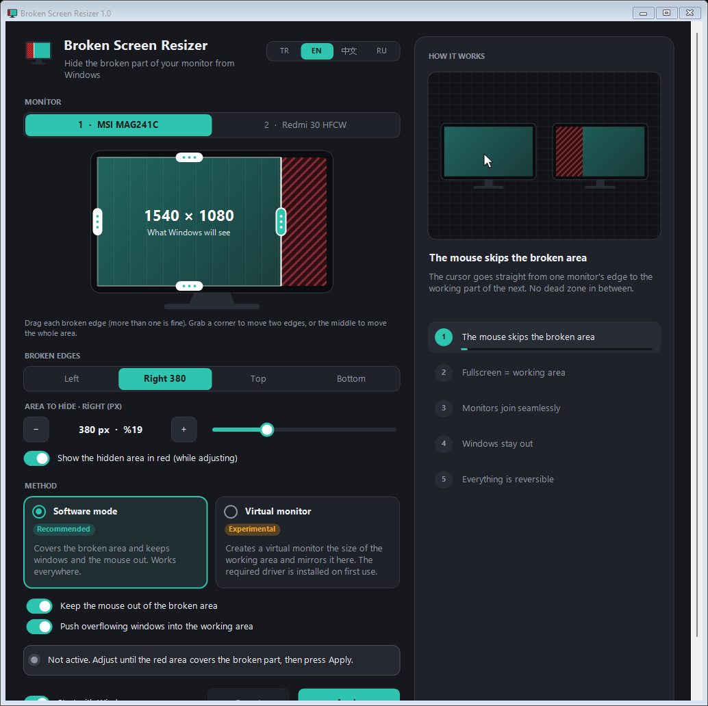

<div align="center">


# Broken Screen Resizer

**Hide the broken part of your monitor from Windows and use the rest like a full screen.**

[](https://github.com/HErkanuzun/BrokenScreenResizer/releases/latest)
[](https://github.com/HErkanuzun/BrokenScreenResizer/releases)
[](https://github.com/HErkanuzun/BrokenScreenResizer/actions/workflows/build.yml)
[](../LICENSE)


🇹🇷 [Türkçe](../README.md) · 🇬🇧 **English** · 🇷🇺 [Русский](README.ru.md) · 🇨🇳 [简体中文](README.zh-CN.md)



</div>

---

## Contents

- [What it does](#what-it-does)
- [Features](#features)
- [Download and install](#download-and-install)
- [How to use](#how-to-use)
- [Methods](#methods)
- [Security and privacy](#security-and-privacy)
- [Updating and uninstalling](#updating-and-uninstalling)
- [Troubleshooting](#troubleshooting)
- [Command line](#command-line)
- [Building from source](#building-from-source)
- [Version history](#version-history)
- [License](#license)

## What it does

Does your monitor have lines, dead pixels or a cracked area along one edge? Broken Screen Resizer hides that area from Windows. Windows then uses the monitor as if it consisted only of the **working part**: windows, the taskbar, full-screen videos and the mouse stay out of the broken area.

Instead of throwing the monitor away or moving windows by hand every day, you set it up once and the app takes care of the rest.

## Features

- **More than one broken edge.** Left, right, top, bottom or several at once; the working area can be any rectangle on the screen.
- **Visual setup.** Drag the edges on the monitor drawing; grab a corner to move two edges, or the middle to move the whole area. A slider and −/+ buttons give pixel-exact control.
- **Live preview.** While you adjust, the area to hide is shown in red on the real screen for a few seconds. The app never paints the screen on its own at startup.
- **Full screen = working area.** Maximized windows and videos use only the working part.
- **Mouse and windows stay out.** The pointer can't enter the broken area; windows that overflow into it are pushed back.
- **Everything is reversible.** Every change asks for confirmation within 15 seconds and reverts on its own if you don't confirm. There is also a one-click emergency reset.
- **Version-aware setup.** The installer updates the app if it is already installed and installs it otherwise; a running older version is closed cleanly first.
- **Complete uninstall.** Uninstalling reverts every change the app made to the computer and leaves nothing behind.
- **Fits small screens.** The window is resizable; on narrow screens it switches to a single scrollable column.
- **4 languages:** Türkçe, English, 中文, Русский.

## Download and install

[**Download the latest release →**](https://github.com/HErkanuzun/BrokenScreenResizer/releases/latest)

| File | When to use it |
|---|---|
| `BrokenScreenResizer-<version>-Setup.exe` | **Recommended.** Installs the app, or updates it if it is already installed. Adds a Start menu entry and shows up with its version in Windows "Apps". Needs no administrator rights. |
| `BrokenScreenResizer-<version>-Portable.zip` | No installation. Extract and run `BrokenScreenResizer.exe`; use `Uninstall.bat` to remove it. |
| `SHA256SUMS.txt` | Checksums to verify that your download was not changed. |

> [!NOTE]
> **"Windows protected your PC":** the app is free and open source, so it has no paid code-signing certificate. SmartScreen may warn about it like any unsigned program with few downloads. Choose **More info → Run anyway** to continue. You can check that the file really comes from this repository as shown below.

### Verifying a download

Every release file is built by GitHub Actions from the source code in this repository. GitHub also records which code and which build produced each file in a signed *build provenance* attestation.

```powershell
# 1) Compare the SHA-256 checksum with SHA256SUMS.txt
Get-FileHash .\BrokenScreenResizer-1.01-Setup.exe -Algorithm SHA256

# 2) Verify that GitHub built the file from this repository (requires the GitHub CLI)
gh attestation verify .\BrokenScreenResizer-1.01-Setup.exe --repo HErkanuzun/BrokenScreenResizer
```

**Requirements:** Windows 10 or 11 (64-bit) and .NET Framework 4.x (included with Windows). The virtual monitor method needs Windows 10 1903 or later.

## How to use

1. Open the app and pick the broken monitor.
2. On the monitor drawing, drag every broken edge inward. While you adjust, the broken area is shown in red on the real screen; stop when the red area covers the broken part exactly. For fine control, pick the edge under **Broken edges** and use the slider or the −/+ buttons.
3. Pick a method (**Software mode** is recommended) and press **Apply**.
4. If the picture looks right, choose **Keep changes**. Otherwise everything reverts after 15 seconds.

With **Start with Windows** turned on, your setup is applied automatically at every sign-in. The app keeps running in the tray.

## Methods

| | Software mode (recommended) | Virtual monitor (experimental) |
|---|---|---|
| How it works | Reserves the broken edges like a taskbar, steers the mouse and pushes overflowing windows back. | Creates a virtual monitor the size of the working area, puts it in place of the physical monitor and mirrors it 1:1 onto the working area. |
| Compatibility | Every system | Windows 10 1903+ / 11, 64-bit. The app's own virtual display driver is embedded in the exe and installed on first use (administrator permission once). |
| Full-screen games | In borderless window mode | In borderless window mode; adds a little latency |
| When the app is closed | The app must keep running | The app must keep running; closing it restores the display layout |

If the virtual monitor method fails, the app changes nothing and offers to use software mode instead.

## Security and privacy

Broken Screen Resizer is open source; everything below can be checked in the code.

- **No network access.** It collects and sends no data and doesn't even check for updates.
- **No administrator rights.** The only exception is installing or removing the virtual monitor driver; Windows asks for permission at that moment.
- **No keyboard monitoring.** Software mode uses a Windows mouse hook only to keep the pointer out of the broken area.
- **What it changes:**
  - Settings: `%AppData%\BrokenScreenResizer\settings.ini`
  - If "Start with Windows" is on: `HKCU\Software\Microsoft\Windows\CurrentVersion\Run\BrokenScreenResizer`
  - If the virtual monitor method was used: the virtual display driver, the certificate that signs it (in the Trusted Root and Trusted Publishers stores) and `C:\ProgramData\BrokenScreenResizer\driver`
- **About the driver certificate:** the driver is signed with a self-signed certificate that is valid for *code signing* only, so it can't intercept websites or email. Its private key never goes into the repository or a release. Uninstalling removes the certificate too.
- **Uninstalling reverts everything.** All of the above, including leftovers from the old "Ekran Kurtar" name, is cleaned up.

Found a security issue? Please follow [SECURITY.md](../SECURITY.md).

## Updating and uninstalling

**Updating:** run the installer of the new version. It finds the existing installation, closes any running older version (portable copies included), installs over it and keeps your settings. With the portable version, just open the new exe; a running older version is closed and replaced.

**Uninstalling:** any of these works:

- Windows **Settings → Apps → Broken Screen Resizer → Uninstall** (if you used the installer)
- **Uninstall…** in the app, or in the tray icon menu
- `Uninstall.bat` in the portable version

Uninstalling restores the displays and removes the virtual driver and its certificate, Windows' records of the virtual monitors, the startup entry and the settings. If the driver is installed, Windows asks for administrator permission once.

## Troubleshooting

<details>
<summary><b>The screen looks wrong, or the wrong monitor was cropped</b></summary>

Click **Emergency: reset all monitors** in the app, or run `BrokenScreenResizer.exe --reset`. As a last resort, set the recommended resolution in Windows **Display settings**.
</details>

<details>
<summary><b>The virtual monitor doesn't start</b></summary>

- You need Windows 10 1903 or later, 64-bit.
- Make sure you approved the administrator prompt during driver installation.
- Check the install log: `C:\ProgramData\BrokenScreenResizer\driver\install.log`
- Restart the computer and try again. If it still fails, use **Software mode**; it works everywhere.
</details>

<details>
<summary><b>A full-screen game spills into the broken area</b></summary>

Run the game in **borderless / windowed fullscreen** mode. Exclusive full-screen mode bypasses Windows' desktop settings.
</details>

<details>
<summary><b>Opening the new version opens the old one</b></summary>

Starting with v1.0, a new version closes a running older version and takes its place. The installer also closes every running copy before installing.
</details>

## Command line

| Command | What it does |
|---|---|
| `BrokenScreenResizer.exe --tray` | Starts in the tray without opening the window (used by Start with Windows) |
| `BrokenScreenResizer.exe --reset` | Emergency: resets all monitors and closes the running copy cleanly |
| `BrokenScreenResizer.exe --uninstall` | Complete uninstall (asks for confirmation) |
| `BrokenScreenResizer.exe --uninstall-driver` | Removes only the virtual display driver |

## Building from source

No extra tools are needed; the .NET Framework 4 compiler that ships with Windows is used.

```bat
build.bat
```

The output is `bin\BrokenScreenResizer.exe`. The prebuilt, signed driver package in `driver\package` is embedded in the exe. Release packages (installer + portable ZIP + checksums) need [Inno Setup 6](https://jrsoftware.org/isinfo.php):

```powershell
powershell -ExecutionPolicy Bypass -File scripts\package.ps1 -Version 1.01
```

<details>
<summary><b>Building the virtual display driver (only if you changed it)</b></summary>

The driver lives in `driver\`: a user-mode (UMDF 2) driver built on Microsoft's IddCx (Indirect Display Driver) framework. You need Visual Studio 2022 or 2026 with the **Desktop development with C++** workload. If the WDK is not installed, the script downloads Microsoft's official NuGet package into `driver\.wdk`.

```bat
driver\build_driver.bat
build.bat
```

`build_driver.bat` builds the driver, creates the catalog and signs both with a self-signed certificate that is created once on the developer's machine. The private key is non-exportable and never leaves that machine; only the public certificate (`.cer`) goes into the package.
</details>

### Project layout

```
src/          The app (C#, WinForms, .NET Framework 4)
driver/       Virtual display driver (C++, IddCx / UMDF 2) and its signed package
installer/    Installer script (Inno Setup)
scripts/      Release packaging
packaging/    Short readme that goes into the portable ZIP
docs/         READMEs in other languages and images
```

## Version history

Details: [CHANGELOG.md](../CHANGELOG.md) · All releases: [Releases](https://github.com/HErkanuzun/BrokenScreenResizer/releases)

- **v1.01** — Content is centered in wide and fullscreen windows. While a setting is applied, the parts that can't be changed are faded and marked as locked, and Revert is highlighted.
- **v1.0** — First stable release: installer (updates or installs), version-aware startup, no red screen and no default cut at startup, antivirus-friendly uninstall, verifiable release files.
- **v0.7** — Driver mode removed; complete uninstall; UI that fits small screens.
- **v0.6** — New name (Broken Screen Resizer), multiple broken edges.
- **v0.5** — Fixed stutter in virtual monitor mode.
- **v0.4** — The app's own virtual display driver.
- **v0.3** — Virtual monitor method.
- **v0.2** — New interface, 4 languages.
- **v0.1** — First release (named Ekran Kurtar).

## License

[MIT](../LICENSE) © 2026 HErkanuzun. Free to use, modify and share.
