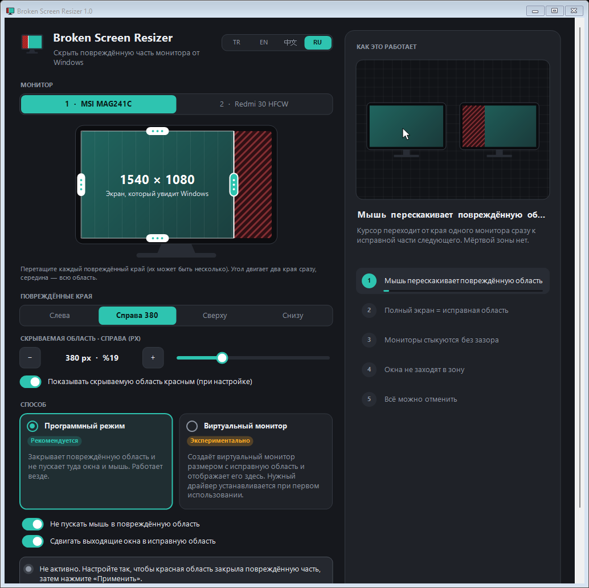

<div align="center">


# Broken Screen Resizer

**Скройте повреждённую часть монитора от Windows и пользуйтесь остальной частью как полным экраном.**

[](https://github.com/HErkanuzun/BrokenScreenResizer/releases/latest)
[](https://github.com/HErkanuzun/BrokenScreenResizer/releases)
[](https://github.com/HErkanuzun/BrokenScreenResizer/actions/workflows/build.yml)
[](../LICENSE)


🇹🇷 [Türkçe](../README.md) · 🇬🇧 [English](README.en.md) · 🇷🇺 **Русский** · 🇨🇳 [简体中文](README.zh-CN.md)



</div>

---

## Содержание

- [Что делает программа](#что-делает-программа)
- [Возможности](#возможности)
- [Загрузка и установка](#загрузка-и-установка)
- [Как пользоваться](#как-пользоваться)
- [Способы](#способы)
- [Умножитель экрана (превью)](#умножитель-экрана-превью)
- [Безопасность и конфиденциальность](#безопасность-и-конфиденциальность)
- [Обновление и удаление](#обновление-и-удаление)
- [Решение проблем](#решение-проблем)
- [Командная строка](#командная-строка)
- [Сборка из исходного кода](#сборка-из-исходного-кода)
- [История версий](#история-версий)
- [Лицензия](#лицензия)

## Что делает программа

На мониторе полосы, битые пиксели или трещина у края? Broken Screen Resizer скрывает эту область от Windows. Windows использует монитор так, будто он состоит только из **исправной части**: окна, панель задач, полноэкранное видео и указатель мыши не заходят в повреждённую область.

Вместо того чтобы выбрасывать монитор или каждый день двигать окна вручную, вы настраиваете всё один раз, остальное программа делает сама.

## Возможности

- **Несколько повреждённых краёв.** Слева, справа, сверху, снизу или сразу несколько; исправная область может быть любым прямоугольником экрана.
- **Наглядная настройка.** Перетаскивайте края на схеме монитора; за угол двигаются два края сразу, за середину — вся область. Ползунок и кнопки −/+ позволяют настроить с точностью до пикселя.
- **Живой предпросмотр.** Во время настройки скрываемая область на несколько секунд подсвечивается красным на реальном экране. При запуске программа никогда сама не закрашивает экран.
- **Полный экран = исправная область.** Развёрнутые окна и видео используют только исправную часть.
- **Мышь и окна не заходят в повреждённую область.** Указатель туда не попадает, а выступающие окна возвращаются обратно.
- **Всё можно отменить.** Каждое изменение нужно подтвердить в течение 15 секунд, иначе оно отменяется само. Есть и аварийный сброс одним щелчком.
- **Установщик учитывает версию.** Если программа уже установлена, установщик её обновит, иначе установит; запущенная старая версия сначала корректно закрывается.
- **Полное удаление.** При удалении отменяются все изменения, которые программа внесла в компьютер, ничего не остаётся.
- **Подходит для маленьких экранов.** Размер окна можно менять; на узком экране интерфейс выстраивается в одну прокручиваемую колонку.
- **4 языка:** Türkçe, English, 中文, Русский.

## Загрузка и установка

[**Скачать последнюю версию →**](https://github.com/HErkanuzun/BrokenScreenResizer/releases/latest)

| Файл | Когда использовать |
|---|---|
| `BrokenScreenResizer-<версия>-Setup.exe` | **Рекомендуется.** Устанавливает программу или обновляет уже установленную. Добавляет ярлык в меню «Пуск» и отображается с номером версии в списке «Приложения» Windows. Права администратора не нужны. |
| `BrokenScreenResizer-<версия>-Portable.zip` | Без установки. Распакуйте и запустите `BrokenScreenResizer.exe`; для удаления — `Uninstall.bat`. |
| `SHA256SUMS.txt` | Контрольные суммы, чтобы убедиться, что файл не изменён. |

> [!NOTE]
> **«Система Windows защитила ваш компьютер»:** программа бесплатная и с открытым кодом, поэтому у неё нет платного сертификата подписи кода. SmartScreen может предупреждать о ней, как о любой неподписанной программе с небольшим числом загрузок. Нажмите **Подробнее → Выполнить в любом случае**. Проверить, что файл действительно собран из этого репозитория, можно так, как описано ниже.

### Проверка загруженного файла

Все файлы выпуска собираются в GitHub Actions из исходного кода этого репозитория. GitHub также подписывает запись о том, из какого кода и какой сборкой получен каждый файл (*build provenance*).

```powershell
# 1) Сравните контрольную сумму SHA-256 с SHA256SUMS.txt
Get-FileHash .\BrokenScreenResizer-1.01-Setup.exe -Algorithm SHA256

# 2) Проверьте, что файл собран GitHub из этого репозитория (нужен GitHub CLI)
gh attestation verify .\BrokenScreenResizer-1.01-Setup.exe --repo HErkanuzun/BrokenScreenResizer
```

**Требования:** Windows 10 или 11 (64 бит), .NET Framework 4.x (входит в Windows). Для способа «Виртуальный монитор» нужна Windows 10 1903 или новее.

## Как пользоваться

1. Откройте программу и выберите повреждённый монитор.
2. На схеме монитора перетащите каждый повреждённый край внутрь. Во время настройки повреждённая область подсвечивается красным на реальном экране; остановитесь, когда красная область точно закроет повреждённую часть. Для точной настройки выберите край в разделе **Повреждённые края** и используйте ползунок или кнопки −/+.
3. Выберите способ (рекомендуется **Программный режим**) и нажмите **Применить**.
4. Если изображение правильное, нажмите **Сохранить**. Иначе через 15 секунд всё вернётся как было.

Если включено **Запускать вместе с Windows**, настройка применяется автоматически при каждом входе в систему. Программа продолжает работать в области уведомлений.

## Способы

| | Программный режим (рекомендуется) | Виртуальный монитор (экспериментально) |
|---|---|---|
| Как работает | Резервирует повреждённые края как панель задач, направляет указатель мыши и возвращает выступающие окна. | Создаёт виртуальный монитор размером с исправную область, ставит его на место физического и копирует изображение 1:1 в исправную область. |
| Совместимость | Любая система | Windows 10 1903+ / 11, 64 бит. Собственный драйвер виртуального дисплея встроен в exe и устанавливается при первом использовании (один раз нужны права администратора). |
| Полноэкранные игры | В режиме окна без рамки | В режиме окна без рамки; добавляет небольшую задержку |
| Когда программа закрыта | Программа должна работать | Программа должна работать; при закрытии расположение дисплеев восстанавливается |

Если способ «Виртуальный монитор» не сработал, программа ничего не меняет и предлагает использовать программный режим.

## Умножитель экрана (превью)

> **Предварительная версия.** Эта функция есть в предварительном выпуске [v1.5](https://github.com/HErkanuzun/BrokenScreenResizer/releases/tag/v1.5) и пока не стабильна. Стабильная версия — **v1.01**. Если что-то не так, [сообщите](https://github.com/HErkanuzun/BrokenScreenResizer/issues).

Делит большой монитор (например, 4K-телевизор) на несколько отдельных мониторов. Каждая часть становится в Windows настоящим монитором: развёрнутое окно занимает только свою часть, а Windows + стрелки перемещают окна между частями.

- **Расположение.** На вкладке **Умножитель экрана** вверху вы перетаскиваете экраны на схеме монитора и меняете их размер. Края прилипают к соседним экранам и к сетке 8 пикселей. **Добавить экран** добавляет экран на свободное место или делит самый большой экран пополам. **Удалить экран** удаляет выбранный. Не более 8 экранов.
- **Столкновения.** Если перетащить экран на соседний, он сначала останавливается и вздрагивает. Перетащите в ту же сторону ещё раз — и соседний экран уменьшится, но не меньше 640×360.
- **Шаблоны.** 2 рядом, 2 друг над другом, 3 столбца, 1 большой + 2, 2 × 2, 1 большой + 3, 3 + 2, 3 × 2, 4 × 2. Шаблоны, которые не помещаются на монитор, затуманены.
- **Рекомендации.** Программа считывает размер монитора из его собственных данных (EDID) и вычисляет плотность пикселей (PPI). По ней даются три рекомендации: без потери качества, рекомендуется и максимум. Например, для 55″ 4K-телевизора — 2 / 4 / 6 экранов. Если размер не удаётся прочитать, диагональ можно ввести вручную.
- **Распределение.** Для каждого экрана показаны разрешение, доля монитора, диагональ в дюймах и качество.

| Качество | Не менее |
|---|---|
| Чётко | 3,5 Мп и 20″ |
| Хорошо | 1,9 Мп и 14″ |
| Пригодно | 1,2 Мп и 10″ |

**Как это работает:** для каждой части открывается виртуальный монитор, физический монитор уходит за них, а изображение каждого виртуального монитора копируется на его место на физическом мониторе (та же техника, что и в способе «виртуальный монитор»). Поэтому программа должна оставаться запущенной; при закрытии расположение экранов восстанавливается. v1.5 использует новую версию (2.0) драйвера виртуального дисплея. При первом использовании Windows один раз запросит права администратора для его обновления. Режим повреждённого экрана работает и с новым драйвером.

Настройка повреждённого экрана и умножитель экрана не могут работать одновременно; чтобы переключиться, сначала нажмите **Отменить**.

## Безопасность и конфиденциальность

Broken Screen Resizer — программа с открытым кодом; всё, что написано ниже, можно проверить в коде.

- **Не выходит в интернет.** Не собирает и не отправляет никаких данных и даже не проверяет обновления.
- **Не требует прав администратора.** Единственное исключение — установка и удаление драйвера виртуального монитора; в этот момент Windows запросит разрешение.
- **Не следит за клавиатурой.** Программный режим использует перехват мыши Windows только для того, чтобы не пускать указатель в повреждённую область.
- **Что изменяется:**
  - Настройки: `%AppData%\BrokenScreenResizer\settings.ini`
  - Если включён автозапуск: `HKCU\Software\Microsoft\Windows\CurrentVersion\Run\BrokenScreenResizer`
  - Если использовался виртуальный монитор: драйвер виртуального дисплея, сертификат, которым он подписан (в хранилищах «Доверенные корневые центры» и «Доверенные издатели»), и `C:\ProgramData\BrokenScreenResizer\driver`
- **О сертификате драйвера:** драйвер подписан самозаверяющим сертификатом, действительным только для *подписи кода*, поэтому он не может вмешиваться в трафик сайтов или почты. Его закрытый ключ никогда не попадает в репозиторий или выпуск. При удалении сертификат тоже удаляется.
- **Удаление отменяет всё.** Всё перечисленное, включая остатки старого названия «Ekran Kurtar», удаляется.

Нашли проблему безопасности? Следуйте [SECURITY.md](../SECURITY.md).

## Обновление и удаление

**Обновление:** запустите установщик новой версии. Он найдёт текущую установку, корректно закроет запущенную старую версию (включая портативные копии), установит поверх и сохранит настройки. В портативной версии достаточно открыть новый exe: запущенная старая версия закроется, и её место займёт новая.

**Удаление:** подойдёт любой способ:

- **Параметры Windows → Приложения → Broken Screen Resizer → Удалить** (если программа установлена установщиком)
- **Удалить программу…** в программе или в меню значка в области уведомлений
- `Uninstall.bat` в портативной версии

Удаление восстанавливает дисплеи и удаляет виртуальный драйвер и его сертификат, записи Windows о виртуальных мониторах, запись автозапуска и настройки. Если драйвер установлен, Windows один раз запросит права администратора.

## Решение проблем

<details>
<summary><b>Экран выглядит неправильно или обрезан не тот монитор</b></summary>

Нажмите **Аварийный сброс всех мониторов** в программе или выполните `BrokenScreenResizer.exe --reset`. В крайнем случае установите рекомендуемое разрешение в **Параметрах экрана** Windows.
</details>

<details>
<summary><b>Виртуальный монитор не запускается</b></summary>

- Нужна Windows 10 1903 или новее, 64 бит.
- Убедитесь, что вы подтвердили запрос прав администратора при установке драйвера.
- Посмотрите журнал установки: `C:\ProgramData\BrokenScreenResizer\driver\install.log`
- Перезагрузите компьютер и попробуйте снова. Если не помогло, используйте **Программный режим** — он работает везде.
</details>

<details>
<summary><b>Полноэкранная игра заходит в повреждённую область</b></summary>

Запустите игру в режиме **окна без рамки** (borderless / windowed fullscreen). Эксклюзивный полноэкранный режим обходит настройки рабочего стола Windows.
</details>

<details>
<summary><b>При запуске новой версии открывается старая</b></summary>

Начиная с v1.0 новая версия закрывает запущенную старую и занимает её место. Установщик тоже закрывает все запущенные копии перед установкой.
</details>

## Командная строка

| Команда | Что делает |
|---|---|
| `BrokenScreenResizer.exe --tray` | Запуск в области уведомлений без окна (используется автозапуском) |
| `BrokenScreenResizer.exe --reset` | Аварийный сброс всех мониторов; корректно закрывает запущенную копию |
| `BrokenScreenResizer.exe --uninstall` | Полное удаление (с подтверждением) |
| `BrokenScreenResizer.exe --uninstall-driver` | Удаляет только драйвер виртуального дисплея |

## Сборка из исходного кода

Дополнительные инструменты не нужны: используется компилятор .NET Framework 4, входящий в Windows.

```bat
build.bat
```

Результат — `bin\BrokenScreenResizer.exe`. Готовый подписанный пакет драйвера из `driver\package` встраивается в exe. Для пакетов выпуска (установщик + портативный ZIP + контрольные суммы) нужен [Inno Setup 6](https://jrsoftware.org/isinfo.php):

```powershell
powershell -ExecutionPolicy Bypass -File scripts\package.ps1 -Version 1.01
```

<details>
<summary><b>Сборка драйвера виртуального дисплея (только если вы его изменили)</b></summary>

Драйвер находится в `driver\`: это драйвер пользовательского режима (UMDF 2) на платформе Microsoft IddCx (Indirect Display Driver). Нужны Visual Studio 2022 или 2026 с компонентом **Разработка классических приложений на C++**. Если WDK не установлен, скрипт скачает официальный пакет NuGet от Microsoft в `driver\.wdk`.

```bat
driver\build_driver.bat
build.bat
```

`build_driver.bat` собирает драйвер, создаёт каталог и подписывает их самозаверяющим сертификатом, который один раз создаётся на компьютере разработчика. Закрытый ключ неэкспортируемый и не покидает этот компьютер; в пакет попадает только открытый сертификат (`.cer`).
</details>

### Структура проекта

```
src/          Программа (C#, WinForms, .NET Framework 4)
driver/       Драйвер виртуального дисплея (C++, IddCx / UMDF 2) и подписанный пакет
installer/    Сценарий установщика (Inno Setup)
scripts/      Упаковка выпусков
packaging/    Краткая инструкция для портативного ZIP
docs/         README на других языках и изображения
```

## История версий

Подробнее: [CHANGELOG.md](../CHANGELOG.md) · Все выпуски: [Releases](https://github.com/HErkanuzun/BrokenScreenResizer/releases)

- **v1.5 (превью)** — Умножитель экрана: разделите большой монитор на 8 отдельных экранов. Редактор с перетаскиванием и раздвиганием, шаблоны, три рекомендации по плотности пикселей. Драйвер виртуального дисплея 2.0. Не стабильная версия.
- **v1.01** — В широком и полноэкранном окне содержимое выравнивается по центру. Пока настройка применена, недоступные элементы затуманены и помечены замком, а кнопка «Отменить» выделена.
- **v1.0** — Первый стабильный выпуск: установщик (обновляет или устанавливает), запуск с учётом версии, нет красного экрана и обрезки по умолчанию при запуске, удаление без подозрительных для антивирусов приёмов, проверяемые файлы выпуска.
- **v0.7** — Удалён режим драйвера; полное удаление; интерфейс для маленьких экранов.
- **v0.6** — Новое название (Broken Screen Resizer), несколько повреждённых краёв.
- **v0.5** — Исправлены подтормаживания в режиме виртуального монитора.
- **v0.4** — Собственный драйвер виртуального дисплея.
- **v0.3** — Способ «Виртуальный монитор».
- **v0.2** — Новый интерфейс, 4 языка.
- **v0.1** — Первый выпуск (под названием Ekran Kurtar).

## Лицензия

[MIT](../LICENSE) © 2026 HErkanuzun. Можно свободно использовать, изменять и распространять.
