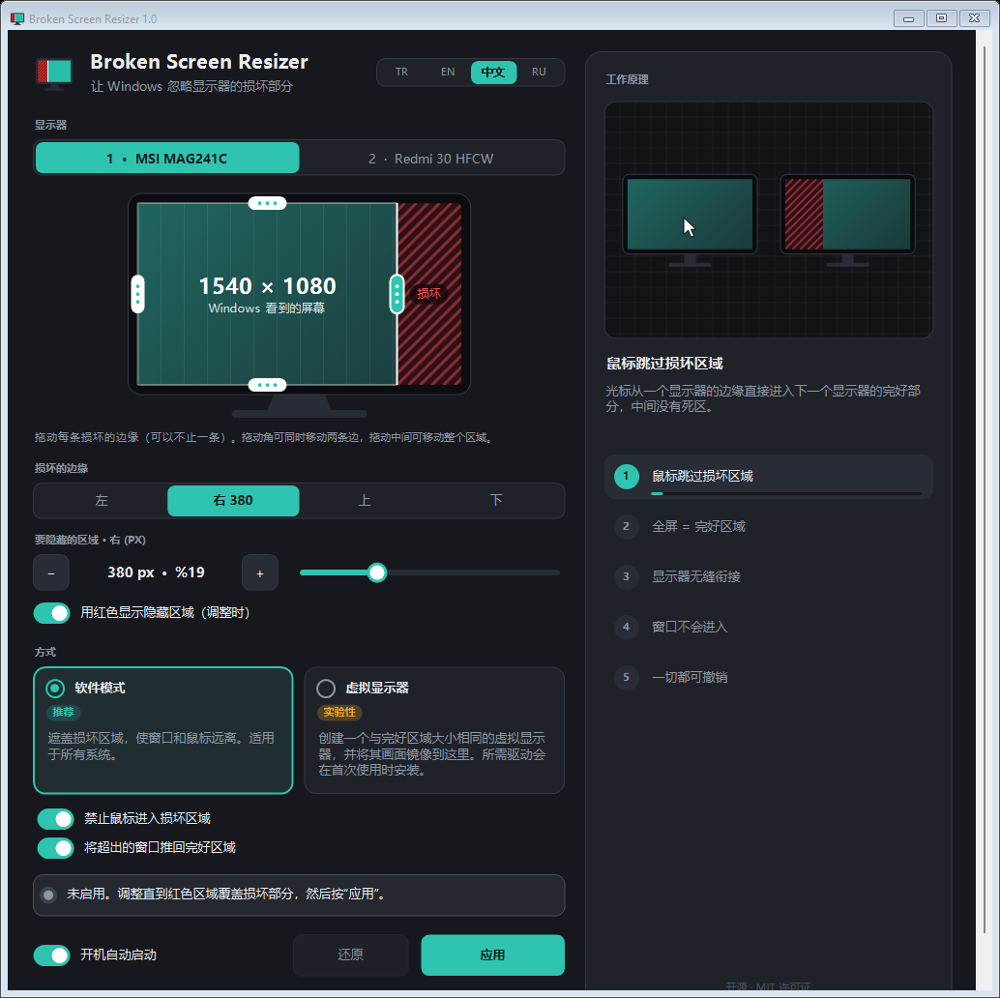

<div align="center">


# Broken Screen Resizer

**让 Windows 忽略显示器的损坏部分，把其余部分当作完整屏幕使用。**

[](https://github.com/HErkanuzun/BrokenScreenResizer/releases/latest)
[](https://github.com/HErkanuzun/BrokenScreenResizer/releases)
[](https://github.com/HErkanuzun/BrokenScreenResizer/actions/workflows/build.yml)
[](../LICENSE)


🇹🇷 [Türkçe](../README.md) · 🇬🇧 [English](README.en.md) · 🇷🇺 [Русский](README.ru.md) · 🇨🇳 **简体中文**



</div>

---

## 目录

- [它能做什么](#它能做什么)
- [功能](#功能)
- [下载与安装](#下载与安装)
- [使用方法](#使用方法)
- [两种方式](#两种方式)
- [安全与隐私](#安全与隐私)
- [更新与卸载](#更新与卸载)
- [常见问题](#常见问题)
- [命令行](#命令行)
- [从源码构建](#从源码构建)
- [版本历史](#版本历史)
- [许可证](#许可证)

## 它能做什么

显示器边缘出现竖线、坏点或裂痕？Broken Screen Resizer 会让 Windows 看不到这块区域。Windows 会把显示器当作只有**完好部分**来使用：窗口、任务栏、全屏视频和鼠标都不会进入损坏区域。

不必扔掉显示器，也不必每天手动挪窗口。只需设置一次，其余交给程序。

## 功能

- **支持多条损坏的边。** 左、右、上、下，或同时多条；完好区域可以是屏幕上任意一个矩形。
- **可视化设置。** 在显示器图中拖动边缘；拖动角可同时移动两条边，拖动中间可移动整个区域。滑块和 −/+ 按钮可精确到像素。
- **实时预览。** 调整时，要隐藏的区域会在真实屏幕上以红色显示几秒钟。程序启动时绝不会自行把屏幕染红。
- **全屏 = 完好区域。** 最大化的窗口和视频只使用完好部分。
- **鼠标和窗口不会进入损坏区域。** 光标进不去，溢出的窗口会被推回。
- **一切都可撤销。** 每次更改都需要在 15 秒内确认，否则自动还原；还有一键紧急重置。
- **按版本安装。** 已安装时安装程序会自动更新，未安装时则全新安装；正在运行的旧版本会先被正常关闭。
- **彻底卸载。** 卸载会撤销程序对电脑所做的一切更改，不留任何残留。
- **适配小屏幕。** 窗口可调整大小；屏幕较窄时自动变为可滚动的单列布局。
- **4 种语言：** Türkçe、English、中文、Русский。

## 下载与安装

[**下载最新版本 →**](https://github.com/HErkanuzun/BrokenScreenResizer/releases/latest)

| 文件 | 适用情况 |
|---|---|
| `BrokenScreenResizer-<版本>-Setup.exe` | **推荐。** 安装程序；如已安装则更新。会添加到开始菜单，并在 Windows“应用”列表中显示版本号。不需要管理员权限。 |
| `BrokenScreenResizer-<版本>-Portable.zip` | 免安装。解压后运行 `BrokenScreenResizer.exe`；用 `Uninstall.bat` 卸载。 |
| `SHA256SUMS.txt` | 校验和，用于确认下载的文件未被修改。 |

> [!NOTE]
> **“Windows 已保护你的电脑”提示：** 本程序免费且开源，没有付费的代码签名证书。和其他下载量较少的未签名程序一样，SmartScreen 可能会发出警告。点击 **更多信息 → 仍要运行** 即可继续。你可以按下面的方法确认文件确实来自本仓库。

### 校验下载的文件

每个发布文件都由 GitHub Actions 用本仓库的源码构建。GitHub 还会用签名记录（*build provenance*）证明每个文件来自哪份代码和哪次构建。

```powershell
# 1) 将 SHA-256 校验和与 SHA256SUMS.txt 对比
Get-FileHash .\BrokenScreenResizer-1.01-Setup.exe -Algorithm SHA256

# 2) 验证文件由 GitHub 用本仓库代码构建（需要 GitHub CLI）
gh attestation verify .\BrokenScreenResizer-1.01-Setup.exe --repo HErkanuzun/BrokenScreenResizer
```

**系统要求：** Windows 10 或 11（64 位），.NET Framework 4.x（Windows 自带）。虚拟显示器方式需要 Windows 10 1903 或更高版本。

## 使用方法

1. 打开程序，选择损坏的显示器。
2. 在显示器图中把每条损坏的边向内拖动。调整时，损坏区域会在真实屏幕上以红色显示；当红色区域正好盖住损坏部分时停止。需要精调时，在 **损坏的边缘** 中选择一条边，然后用滑块或 −/+ 按钮调整。
3. 选择方式（推荐 **软件模式**），然后点击 **应用**。
4. 如果画面正确，选择 **保留更改**。否则 15 秒后一切会自动还原。

开启 **开机自动启动** 后，每次登录都会自动应用设置。程序会继续在系统托盘中运行。

## 两种方式

| | 软件模式（推荐） | 虚拟显示器（实验性） |
|---|---|---|
| 工作原理 | 像任务栏一样预留损坏的边，引导鼠标，并把溢出的窗口推回。 | 创建一个与完好区域大小相同的虚拟显示器，替换物理显示器的位置，并把画面 1:1 镜像到完好区域。 |
| 兼容性 | 所有系统 | Windows 10 1903+ / 11，64 位。程序自带的虚拟显示驱动内嵌在 exe 中，首次使用时安装（需要一次管理员权限）。 |
| 全屏游戏 | 使用无边框窗口模式 | 使用无边框窗口模式；会增加少量延迟 |
| 程序关闭时 | 程序需保持运行 | 程序需保持运行；关闭后显示布局恢复原样 |

如果虚拟显示器方式失败，程序不会做任何更改，并建议改用软件模式。

## 安全与隐私

Broken Screen Resizer 是开源软件；以下内容都可以在代码中核实。

- **不联网。** 不收集、不发送任何数据，甚至不检查更新。
- **不需要管理员权限。** 唯一的例外是安装或卸载虚拟显示驱动，届时 Windows 会请求授权。
- **不监听键盘。** 软件模式只使用 Windows 鼠标钩子，让光标留在损坏区域之外。
- **会更改什么：**
  - 设置：`%AppData%\BrokenScreenResizer\settings.ini`
  - 开启开机自动启动时：`HKCU\Software\Microsoft\Windows\CurrentVersion\Run\BrokenScreenResizer`
  - 使用过虚拟显示器方式时：虚拟显示驱动、为其签名的证书（位于“受信任的根证书颁发机构”和“受信任的发布者”存储中），以及 `C:\ProgramData\BrokenScreenResizer\driver`
- **关于驱动证书：** 驱动使用自签名证书签名，该证书只能用于*代码签名*，无法干预网站或邮件流量。其私钥从不进入仓库或发布文件。卸载时证书也会被删除。
- **卸载会还原一切。** 上述所有内容（包括旧名称“Ekran Kurtar”的残留）都会被清理。

发现安全问题？请按照 [SECURITY.md](../SECURITY.md) 操作。

## 更新与卸载

**更新：** 运行新版本的安装程序即可。它会找到现有安装，正常关闭正在运行的旧版本（包括便携版），覆盖安装并保留你的设置。便携版只需打开新的 exe：正在运行的旧版本会被关闭并由新版本接替。

**卸载：** 以下任一方式均可：

- Windows **设置 → 应用 → Broken Screen Resizer → 卸载**（如果使用安装程序安装）
- 程序中或托盘图标菜单中的 **卸载…**
- 便携版中的 `Uninstall.bat`

卸载会恢复显示器设置，并删除虚拟驱动及其证书、Windows 关于虚拟显示器的记录、开机启动项和设置。如果安装了驱动，Windows 会请求一次管理员权限。

## 常见问题

<details>
<summary><b>屏幕显示异常，或裁剪了错误的显示器</b></summary>

在程序中点击 **紧急情况：重置所有显示器**，或运行 `BrokenScreenResizer.exe --reset`。最后的办法是在 Windows **显示设置** 中把分辨率改回“推荐”。
</details>

<details>
<summary><b>虚拟显示器无法启动</b></summary>

- 需要 Windows 10 1903 或更高版本，64 位。
- 确认安装驱动时已同意管理员权限请求。
- 查看安装日志：`C:\ProgramData\BrokenScreenResizer\driver\install.log`
- 重启电脑后再试。仍然不行就使用 **软件模式**，它适用于所有系统。
</details>

<details>
<summary><b>全屏游戏进入了损坏区域</b></summary>

请以 **无边框窗口**（borderless / windowed fullscreen）模式运行游戏。独占全屏模式会绕过 Windows 的桌面设置。
</details>

<details>
<summary><b>打开新版本时却打开了旧版本</b></summary>

从 v1.0 起，新版本会关闭正在运行的旧版本并取而代之。安装程序在安装前也会关闭所有正在运行的副本。
</details>

## 命令行

| 命令 | 作用 |
|---|---|
| `BrokenScreenResizer.exe --tray` | 不打开窗口，直接在托盘中启动（开机自动启动使用此方式） |
| `BrokenScreenResizer.exe --reset` | 紧急情况：重置所有显示器，并正常关闭正在运行的副本 |
| `BrokenScreenResizer.exe --uninstall` | 彻底卸载（会先确认） |
| `BrokenScreenResizer.exe --uninstall-driver` | 只卸载虚拟显示驱动 |

## 从源码构建

无需额外工具；使用 Windows 自带的 .NET Framework 4 编译器。

```bat
build.bat
```

输出为 `bin\BrokenScreenResizer.exe`。`driver\package` 中预先构建并已签名的驱动包会嵌入到 exe 中。构建发布包（安装程序 + 便携版 ZIP + 校验和）需要 [Inno Setup 6](https://jrsoftware.org/isinfo.php)：

```powershell
powershell -ExecutionPolicy Bypass -File scripts\package.ps1 -Version 1.01
```

<details>
<summary><b>构建虚拟显示驱动（仅在修改驱动后需要）</b></summary>

驱动位于 `driver\`：基于 Microsoft IddCx（间接显示驱动）框架的用户模式（UMDF 2）驱动。需要 Visual Studio 2022 或 2026，并安装 **使用 C++ 的桌面开发** 工作负载。如果未安装 WDK，脚本会把 Microsoft 官方 NuGet 包下载到 `driver\.wdk`。

```bat
driver\build_driver.bat
build.bat
```

`build_driver.bat` 会构建驱动、生成目录文件，并用开发者电脑上一次性创建的自签名证书签名。私钥不可导出，也不会离开那台电脑；驱动包中只包含公开证书（`.cer`）。
</details>

### 项目结构

```
src/          程序（C#、WinForms、.NET Framework 4）
driver/       虚拟显示驱动（C++、IddCx / UMDF 2）及已签名的驱动包
installer/    安装程序脚本（Inno Setup）
scripts/      发布打包
packaging/    便携版 ZIP 中的简短说明
docs/         其他语言的 README 和图片
```

## 版本历史

详情：[CHANGELOG.md](../CHANGELOG.md) · 所有版本：[Releases](https://github.com/HErkanuzun/BrokenScreenResizer/releases)

- **v1.01** — 在宽窗口和全屏时内容居中显示。设置生效期间，无法更改的部分会变为雾化并标记为锁定，“还原”按钮会突出显示。
- **v1.0** — 首个稳定版：安装程序（已安装则更新，否则安装）、按版本启动、启动时不再显示红色屏幕或默认裁剪、对杀毒软件友好的卸载方式、可验证的发布文件。
- **v0.7** — 移除驱动模式；彻底卸载；适配小屏幕的界面。
- **v0.6** — 新名称（Broken Screen Resizer），支持多条损坏的边。
- **v0.5** — 修复虚拟显示器模式下的卡顿。
- **v0.4** — 程序自带的虚拟显示驱动。
- **v0.3** — 虚拟显示器方式。
- **v0.2** — 新界面，4 种语言。
- **v0.1** — 首个版本（当时名为 Ekran Kurtar）。

## 许可证

[MIT](../LICENSE) © 2026 HErkanuzun。可自由使用、修改和分发。
